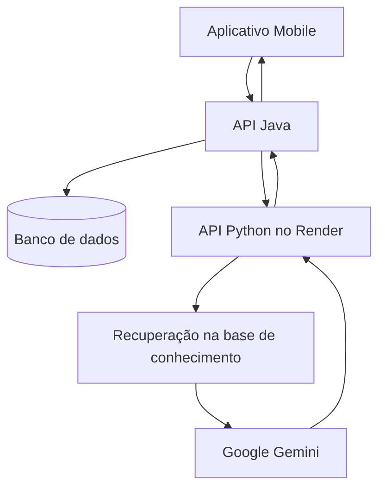

# BeaconSync IA

API de inteligência artificial do projeto **BeaconSync**, desenvolvida para a disciplina **Disruptive Architectures: IoT, IoB & Generative IA**, da Global Solution 2026/2 — CitizenTech.

A funcionalidade ajuda a interpretar dados agregados de pessoas vulneráveis durante alertas, apresentando um boletim numérico e uma explicação fundamentada na base de conhecimento do projeto.

O serviço utiliza **FastAPI**, **RAG lexical com TF-IDF** e **Google Gemini**, com publicação no **Render**.

## Integrantes

| Nome completo | RM |
|---|---|
| PREENCHER | PREENCHER |
| PREENCHER | PREENCHER |
| PREENCHER | PREENCHER |

**Turma:** PREENCHER

## Vídeo de demonstração

[▶ Assistir à demonstração do BeaconSync IA](https://youtu.be/ciTomOALB-c)

## Serviço publicado

| Recurso | Endereço |
|---|---|
| URL base | https://beaconsync-ia.onrender.com |
| Verificação do serviço | https://beaconsync-ia.onrender.com/health |
| Documentação interativa — Swagger | https://beaconsync-ia.onrender.com/docs |
| Contrato OpenAPI | https://beaconsync-ia.onrender.com/openapi.json |

A rota de análise é:

```http
POST https://beaconsync-ia.onrender.com/ia/analisar-distrito
```

A análise exige autenticação pelo cabeçalho `X-API-Key`.

O endpoint `/health` informa se a aplicação está respondendo e qual modo está configurado. Ele não testa a chave, a cota ou a disponibilidade do Gemini.

## 1. Problema e objetivo

Durante uma situação de risco, responsáveis e equipes de apoio precisam compreender informações como:

- Quantas pessoas precisam de ajuda.
- Quantas estão sem contato.
- Quantas aguardam confirmação.
- Quantas foram confirmadas como seguras.
- Quantas foram resgatadas.

O BeaconSync IA transforma essas contagens em um boletim e utiliza a base de conhecimento para explicar os conceitos envolvidos.

A funcionalidade apoia a interpretação das informações. Ela não prevê enchentes, não determina prioridades de resgate e não substitui profissionais ou autoridades.

## 2. Funcionamento

1. O aplicativo solicita uma análise ao backend Java.
2. O Java valida as permissões e prepara os dados agregados do alerta e do distrito.
3. A API Python recebe as contagens e a pergunta.
4. O sistema calcula os totais e monta o boletim numérico por código.
5. O recuperador busca trechos relacionados à pergunta.
6. No modo `gemini`, os dados e os trechos recuperados são enviados ao modelo generativo.
7. A resposta retorna ao Java e é apresentada no aplicativo.

O cálculo dos totais não depende do modelo:

```text
total_acompanhamento =
    precisa_ajuda + sem_contato + pendente_confirmacao

total_cadastrado =
    precisa_ajuda + sem_contato + pendente_confirmacao
    + segura + resgatada
```

Cada pessoa deve aparecer em apenas uma situação no mesmo recorte. A deduplicação e a classificação são responsabilidades do backend que prepara os dados.

## 3. Arquitetura



### Responsabilidades

| Componente | Responsabilidade |
|---|---|
| Mobile | Exibir o mapa, as contagens e a análise |
| Java | Autenticar usuários, autorizar o acesso e preparar os dados enviados à IA |
| Python | Validar a entrada, calcular o boletim, recuperar fontes e consultar o Gemini |
| Base de conhecimento | Fornecer trechos utilizados para fundamentar a explicação |
| Gemini | Gerar a explicação a partir dos dados e documentos recebidos |
| .NET | Gerenciar o cadastro de voluntariado e sua disponibilidade, em um fluxo separado da análise |

O mobile acessa a IA por meio do Java. A chave do serviço Python não deve ser incluída no aplicativo.

A API Python não acessa diretamente o Oracle, não cadastra pessoas e não gera os polígonos do mapa.

## 4. IA generativa e aprofundamento em RAG

O aprofundamento técnico escolhido é **RAG básico**, combinando recuperação de documentos com geração de texto.

### Recuperação

A implementação utiliza:

- Normalização do texto e dos acentos.
- Remoção de palavras comuns.
- Representação dos documentos por TF-IDF.
- Comparação por similaridade cosseno.
- Recuperação de até três trechos acima do limiar experimental de `0,12`.

### Geração

Os trechos recuperados, a pergunta e os dados agregados são enviados ao Gemini. O modelo recebe instruções para:

- Responder em português brasileiro.
- Utilizar os dados e documentos fornecidos.
- Citar os identificadores dos trechos utilizados.
- Reconhecer quando a base não permite responder.
- Não inventar números, previsões ou protocolos de resgate.
- Preservar a decisão operacional humana.

### Justificativa

O RAG permite fornecer contexto específico do BeaconSync ao modelo sem treinar um modelo próprio.

A recuperação lexical foi escolhida pela simplicidade, transparência e facilidade de reprodução. Como depende de palavras compartilhadas, pode apresentar dificuldades com sinônimos e perguntas formuladas de maneiras diferentes.

A similaridade retornada indica proximidade lexical, não uma probabilidade de a resposta estar correta.

### Base de conhecimento

O arquivo `dados/base_conhecimento.json` contém seis trechos sobre conceitos do projeto, incluindo contagens, situações, duplicidade, privacidade e limites de atuação.

Os textos são definições do BeaconSync. Não constituem protocolos oficiais da Defesa Civil.

## 5. Tecnologias

| Tecnologia | Uso |
|---|---|
| Python | Implementação do serviço |
| FastAPI | API REST e documentação OpenAPI |
| Pydantic | Validação dos contratos de entrada e saída |
| Uvicorn | Servidor da aplicação |
| HTTPX | Comunicação HTTP com o Gemini |
| python-dotenv | Carregamento das configurações locais |
| TF-IDF e similaridade cosseno | Recuperação lexical |
| Google Gemini | Geração da explicação |
| Render | Hospedagem da API |
| unittest | Testes automatizados |

As versões das dependências estão fixadas em `requirements.txt`.

## 6. Configuração

### Variáveis de ambiente

| Variável | Finalidade |
|---|---|
| `IA_MODO` | Define `gemini` ou `demonstracao` |
| `SERVICE_API_KEY` | Chave de acesso ao serviço Python, com pelo menos 32 caracteres |
| `GEMINI_API_KEY` | Credencial do provedor Gemini |
| `GEMINI_MODEL` | Identificador do modelo disponível na conta, sem o prefixo `models/` |

Para geração real:

```dotenv
IA_MODO=gemini
SERVICE_API_KEY=SUA_CHAVE_PRIVADA_DE_SERVICO
GEMINI_API_KEY=SUA_CHAVE_DO_GEMINI
GEMINI_MODEL=IDENTIFICADOR_DO_MODELO_DA_SUA_CONTA
```

Os valores acima são exemplos e precisam ser substituídos nas configurações do servidor.

Não publique credenciais no GitHub, no README, no vídeo ou no aplicativo.

### Configuração no Java

```dotenv
IA_BASE_URL=https://beaconsync-ia.onrender.com
IA_SERVICE_API_KEY=MESMO_VALOR_DE_SERVICE_API_KEY_DO_PYTHON
```

O Java envia a chave ao Python no cabeçalho:

```http
X-API-Key: <chave-do-servico>
```

Essa chave é diferente do JWT utilizado pelos usuários no aplicativo.

### Configuração no Render

**Build Command:**

```bash
pip install -r requirements.txt
```

**Start Command:**

```bash
uvicorn main:app --host 0.0.0.0 --port $PORT
```

**Health Check Path:**

```text
/health
```

Configure as variáveis na área de ambiente do serviço.

O arquivo `render.yaml` mantém `IA_MODO=demonstracao` como configuração inicial. Para utilizar geração real, confira se o serviço publicado está configurado com `IA_MODO=gemini`, chave e modelo válidos.

## 7. Executar localmente

Requisito: Python 3.12 ou posterior compatível com as dependências.

Clone o repositório:

```bash
git clone https://github.com/BeaconSync/BeaconSync-IA.git
cd BeaconSync-IA
```

No PowerShell:

```powershell
py -3.12 -m venv .venv
.\.venv\Scripts\python.exe -m pip install -r requirements.txt
.\.venv\Scripts\python.exe configurar.py
```

Revise o `.env` gerado. Para usar Gemini, configure o modo, a credencial e o modelo.

Inicie a aplicação:

```powershell
.\.venv\Scripts\python.exe -m uvicorn main:app --reload
```

Acesse:

- Swagger: http://127.0.0.1:8000/docs
- Health: http://127.0.0.1:8000/health

Reinicie a aplicação após alterar as variáveis de ambiente.

## 8. Utilizar a API

### Autenticação

No Swagger:

1. Clique em **Authorize**.
2. Informe o valor de `SERVICE_API_KEY`.
3. Abra `POST /ia/analisar-distrito`.
4. Clique em **Try it out**.
5. Preencha o corpo e execute.

### Exemplo de entrada

Os dados abaixo são fictícios. Atualize `atualizado_em` para o instante correspondente aos dados, incluindo o fuso horário.

```json
{
  "alerta_id": "alerta-exemplo-01",
  "distrito_id": "distrito-exemplo-01",
  "distrito_nome": "Distrito Exemplo",
  "atualizado_em": "2026-11-19T14:00:00-03:00",
  "situacoes": {
    "precisa_ajuda": 10,
    "sem_contato": 5,
    "pendente_confirmacao": 3,
    "segura": 4,
    "resgatada": 2
  },
  "pergunta": "Como interpretar a contagem de pessoas em acompanhamento no distrito?"
}
```

Nesse exemplo, os totais esperados são:

- **18 pessoas em acompanhamento.**
- **24 pessoas cadastradas no recorte.**

### Validações

- Quantidades devem ser inteiros entre `0` e `1.000.000`.
- Valores negativos, frações e booleanos não são aceitos como quantidades.
- A data deve incluir fuso horário.
- Datas mais de cinco minutos no futuro são rejeitadas.
- Dados com mais de quinze minutos geram um aviso.
- Campos adicionais não previstos no contrato são rejeitados.
- A pergunta, quando informada, deve ter entre 5 e 500 caracteres.

### Resposta

A resposta inclui:

- Identificador da análise.
- Modo, status e modelo utilizado.
- Identificadores do alerta e do distrito.
- Data dos dados e data de geração.
- Totais calculados.
- Boletim numérico.
- Explicação.
- Fontes recuperadas.
- Avisos e limitações.

| Status | Significado |
|---|---|
| `GERADO` | A explicação foi recebida do Gemini |
| `SEM_BASE` | Nenhum trecho atingiu o limiar de recuperação; o Gemini não foi chamado |
| `DEMONSTRACAO` | Resposta de simulação, sem geração por modelo |

O modo de demonstração auxilia no desenvolvimento, mas não comprova o funcionamento da IA generativa.

### Erros

| HTTP | Significado |
|---|---|
| `401` | Chave de serviço ausente ou inválida |
| `422` | Dados de entrada inválidos |
| `502` | Falha externa ou resposta incompleta, vazia ou bloqueada |
| `503` | Falha de conexão, cota ou configuração do provedor |
| `504` | Tempo de resposta do provedor excedido |

Uma falha na análise deve ser apresentada ao usuário sem apagar o mapa e as contagens já carregadas.

## 9. Testes e avaliação

Execute os testes automatizados:

```powershell
.\.venv\Scripts\python.exe -m unittest discover -s tests -v
```

Execute a avaliação da recuperação:

```powershell
.\.venv\Scripts\python.exe avaliar_rag.py
```

Os testes cobrem autenticação, validação, contagem, datas, recuperação e tratamento de falhas, utilizando o provedor simulado.

O script de RAG avalia:

- Se a fonte esperada aparece entre os três primeiros resultados.
- Se perguntas fora da base são rejeitadas.

Essas métricas avaliam a recuperação em um conjunto pequeno de exemplos conhecidos. Elas não representam a acurácia das respostas generativas.

### Avaliação com Gemini

Para registrar evidências de geração real, documente:

- Pergunta e dados fictícios utilizados.
- Modelo e data da execução.
- Resposta recebida.
- Fontes recuperadas.
- Coerência com os documentos e com os totais.
- Limitações ou erros identificados.

Inclua casos de funcionamento normal, ausência de dados, pergunta fora do assunto e indisponibilidade do provedor.

Os testes automatizados não substituem a avaliação das respostas reais nem a validação do fluxo completo com Java e mobile.

Materiais complementares:

- [Avaliação e limitações](docs/AVALIACAO.md)
- [Contrato da API Python](docs/INTEGRACAO.md)
- [Entrada de exemplo](exemplos/distrito.json)

Esses documentos complementares incluem registros da preparação inicial; diferencie essas evidências de testes realizados posteriormente no serviço publicado.

## 10. Segurança e limitações

- A API trabalha com contagens agregadas, sem necessidade de nomes, documentos ou endereços individuais.
- A pergunta e o nome do distrito são textos livres; o backend deve impedir o envio de informações pessoais nesses campos.
- As chaves permanecem nos servidores.
- O Python confia nas contagens recebidas e não verifica os registros no banco.
- A ausência de cadastros não significa que uma região esteja segura.
- O RAG pode recuperar trechos inadequados ou deixar de encontrar trechos relevantes.
- A resposta generativa pode conter erros, mesmo quando apresenta referências.
- As instruções ao modelo não eliminam completamente tentativas de manipulação do prompt.
- O serviço não faz previsão meteorológica nem define prioridade de atendimento.
- O modelo não possui acesso direto ao banco de dados.
- Não há coleta de sensores nesta implementação; o aprofundamento técnico escolhido é RAG.

## 11. Organização do projeto

| Caminho | Conteúdo |
|---|---|
| `main.py` | Aplicação FastAPI, autenticação e fluxo da análise |
| `app/schemas.py` | Validação dos dados |
| `app/rag.py` | Recuperação lexical |
| `app/provider.py` | Comunicação com o Gemini |
| `dados/base_conhecimento.json` | Base de conhecimento |
| `exemplos/distrito.json` | Dados fictícios para teste |
| `tests/` | Testes automatizados |
| `avaliar_rag.py` | Avaliação da recuperação |
| `configurar.py` | Preparação das configurações locais |
| `docs/` | Documentação complementar |
| `requirements.txt` | Dependências |
| `render.yaml` | Configuração de publicação |
| `.env.example` | Exemplo de variáveis sem credenciais |

## 12. Relação com a Global Solution

A proposta utiliza IA generativa para apoiar a compreensão de informações sobre pessoas vulneráveis durante alertas.

O aprofundamento em RAG combina uma base de conhecimento do projeto com geração de texto, permitindo demonstrar recuperação, fundamentação e avaliação das respostas.

A solução se relaciona aos ODS:

- **ODS 3:** Saúde e bem-estar.
- **ODS 10:** Redução das desigualdades.
- **ODS 11:** Cidades e comunidades sustentáveis.
- **ODS 13:** Ação contra a mudança global do clima.

Essas relações representam a contribuição pretendida pelo projeto. O impacto social real ainda não foi mensurado.

## Uso de IA no desenvolvimento

O projeto contou com apoio do ChatGPT/Codex na elaboração de código, documentação e testes. A equipe é responsável por revisar, compreender e validar a solução apresentada.

## Referências

- [FastAPI](https://fastapi.tiangolo.com/)
- [Pydantic](https://docs.pydantic.dev/)
- [Google Gemini — generateContent](https://ai.google.dev/api/generate-content)
- [Publicação de FastAPI no Render](https://render.com/docs/deploy-fastapi)
