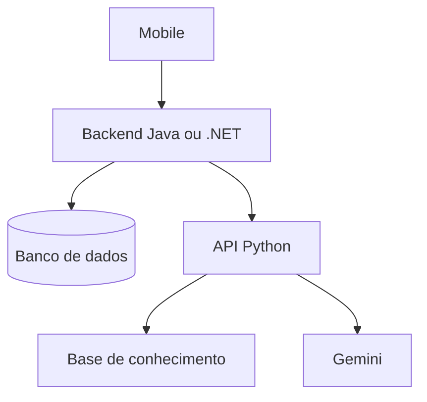

# BeaconSync IA — primeira versão (0.1.0)

API acadêmica para explicar a situação de um distrito durante um alerta. Recebe contagens agregadas do backend, produz um boletim numérico por código e recupera documentos do projeto para fundamentar uma explicação com Gemini.

**Estado:** primeira versão local, com simulação sem custo e integração real preparada. Não está publicada, não está conectada a Java/.NET/mobile e ainda não foi validada com uma chave real. A simulação não atende sozinha ao requisito de IA generativa.

## 1. Rodar no Windows, pelo terminal do VS Code

Instale Python 3.12 ou posterior e abra esta pasta (a que contém `main.py`). No PowerShell:

```powershell
py -3.12 -m venv .venv
.\.venv\Scripts\python.exe -m pip install -r requirements.txt
.\.venv\Scripts\python.exe configurar.py
.\.venv\Scripts\python.exe -m uvicorn main:app --reload
```

Se o computador tiver outra versão compatível, use `py -m venv .venv`. Não é necessário ativar o ambiente virtual nem alterar a política de execução do PowerShell.

Abra http://127.0.0.1:8000/docs. O endereço http://127.0.0.1:8000/health deve retornar `status: ok`.

1. Abra `.env` no VS Code e copie somente o valor de `SERVICE_API_KEY`.
2. No Swagger, clique em **Authorize**, cole a chave e confirme.
3. Abra `POST /ia/analisar-distrito` e clique em **Try it out**.
4. Cole o conteúdo de `exemplos/distrito.json`; ajuste `atualizado_em` para a data/hora atual com fuso (ex.: `-03:00`).
5. Clique em **Execute**. Espere HTTP 200, `status: DEMONSTRACAO`, 18 pessoas em acompanhamento e 24 cadastradas.

O exemplo antigo continua válido, mas retorna aviso de dados desatualizados. A chave gerada protege a API entre servidores; nunca coloque essa chave no código mobile.

## 2. O que cada arquivo faz

| Arquivo | Função |
|---|---|
| `main.py` | Rotas, autenticação, boletim e fluxo da análise |
| `app/schemas.py` | Contrato JSON e validação |
| `app/rag.py` | Busca lexical TF-IDF e similaridade cosseno |
| `app/provider.py` | Integração REST com Gemini e tratamento de falhas |
| `dados/base_conhecimento.json` | Seis trechos curtos do projeto, com origem identificada |
| `exemplos/distrito.json` | Entrada fictícia para Swagger |
| `tests/test_api.py` | Testes da API e do adaptador com provedor simulado |
| `avaliar_rag.py` | Avaliação local da recuperação |
| `docs/INTEGRACAO.md` | Contrato para alinhar com Java/.NET/mobile |
| `docs/AVALIACAO.md` | Evidências e roteiro para validar geração real |

## 3. Ativar IA generativa real

Crie ou consulte sua chave no [Google AI Studio](https://aistudio.google.com/). No `.env` local:

```dotenv
IA_MODO=gemini
SERVICE_API_KEY=mantenha_a_chave_local_gerada
GEMINI_API_KEY=preencha_sua_chave_real
GEMINI_MODEL=preencha_o_id_de_um_modelo_disponivel_na_sua_conta
```

Os dois últimos valores acima são placeholders, não credenciais/modelos válidos. Copie o identificador de um modelo que suporte `generateContent`, sem o prefixo `models/`. Não fixamos um nome porque disponibilidade, limites e permissões dependem da conta. Verifique a cota antes de testar. Não envie sua chave em mensagens ou commits.

Pare o servidor com Ctrl+C e execute novamente o comando do Uvicorn. Alterações no `.env` exigem reinício. Repita a solicitação no Swagger. Uma geração bem-sucedida retorna `status: GERADO` e o modelo configurado. `SEM_BASE` significa que a busca não encontrou fontes; nesse caso não há chamada ao Gemini. Uma falha externa retorna erro, nunca uma resposta simulada disfarçada de IA.

## 4. Como o RAG funciona

1. Carrega os trechos locais ao iniciar o servidor.
2. Normaliza acentos, separa palavras e remove palavras comuns.
3. Calcula vetores TF-IDF para os documentos.
4. Compara a pergunta com cada documento por similaridade cosseno.
5. Recupera até três trechos acima do limiar experimental 0,12.
6. Envia pergunta, dados agregados e trechos ao modelo.
7. Retorna a explicação e os trechos recuperados para conferência.

É **RAG lexical básico**, sem embeddings neurais ou treino de um classificador. TF-IDF é a técnica de recuperação; Gemini faz a geração. Não há necessidade de sensores neste protótipo. A busca lexical é simples e reproduzível, mas perde sinônimos e pode recuperar trechos irrelevantes. O limiar precisa ser avaliado com novas perguntas.

Os documentos são adaptações da proposta do grupo e definições deste contrato inicial, **não protocolos oficiais da Defesa Civil**. Sua origem e status estão registrados. Para ampliar o escopo, adicionar material oficial revisado com URL, data e trechos próprios; não inventar orientações de salvamento. O conteúdo atual permite explicar o aplicativo, não orientar resgates reais.

## 5. Arquitetura proposta



O backend autoriza usuário/alerta/distrito, agrega dados e envia o recorte à API Python. O mobile desenha o mapa com dados do backend e GeoJSON. A análise é uma chamada separada: falha no Gemini não impede mostrar o mapa. O backend deve manter os dados e devolver erros de IA adequadamente.

Esta API não cadastra pessoas, não consulta Oracle, não calcula polígonos, não fornece um GeoJSON e não implementa o endpoint do mapa. Esses pontos dependem dos contratos das outras APIs. Não assumimos a divisão final Java/.NET. Se Java precisar demonstrar Spring AI pela rubrica da sua disciplina, uma chamada HTTP ao Python não comprova automaticamente esse requisito; alinhar uma funcionalidade compatível com o responsável.

## 6. Publicar no Render (após o teste local)

1. Crie um repositório para o serviço e envie os arquivos, sem `.env` e sem `.venv`.
2. Crie um **Web Service** no Render conectado a esse repositório.
3. Selecione Python e configure:
   - Build: `pip install -r requirements.txt`
   - Start: `uvicorn main:app --host 0.0.0.0 --port $PORT`
   - Health check: `/health`
4. Configure as variáveis do `.env` na área de ambiente do serviço. Gere uma chave exclusiva para `SERVICE_API_KEY`, com pelo menos 32 caracteres; não reutilize a chave de teste.
5. Para simulação, use `IA_MODO=demonstracao`. Para geração real, use `IA_MODO=gemini` com chave e modelo válidos.
6. Escolha o plano conforme disponibilidade e custo mostrados no painel. O projeto não depende de um plano específico.
7. Depois do deploy, teste `/health` e `/docs`. Compartilhe a URL e o contrato com o backend; compartilhe a chave por canal privado.

O `render.yaml` também descreve o serviço para Blueprint. Ele inicia em demonstração; configure o modo e as credenciais no painel quando ativar Gemini.

## 7. Testar e avaliar

```powershell
.\.venv\Scripts\python.exe -m unittest discover -s tests -v
.\.venv\Scripts\python.exe avaliar_rag.py
```

Leia `docs/AVALIACAO.md`. O sucesso dos testes não garante a qualidade das respostas do modelo. Antes da entrega, execute casos reais com a chave, registre modelo/data/resultados e avalie as afirmações contra os documentos.

## 8. Uso responsável e limitações

- Recebe números agregados; não envia registros individuais ao modelo. Pergunta e nome do distrito são texto livre: o backend deve impedir dados pessoais nesses campos; o schema não detecta todo dado pessoal.
- As cinco situações são mutuamente exclusivas neste contrato. O backend deve deduplicar e classificar cada pessoa uma única vez no mesmo alerta/distrito.
- A API confia nos totais recebidos: não consegue detectar duplicidade ou contagem incorreta no banco.
- Boletim e totais são determinísticos. A explicação generativa pode conter erros; as fontes recuperadas não são certificação automática de correção.
- Não decide quem será resgatado primeiro, não prevê clima e não substitui autoridades. Zero cadastros não significa segurança.
- Prompts reduzem comportamentos indesejados, mas não eliminam injeção de prompt. O modelo não tem ferramentas nem acesso ao banco.
- Autenticação por chave de serviço é inicial. Para exposição real: backend com JWT e autorização por órgão/área, controle de taxa, monitoramento e auditoria sem conteúdo sensível. Não chamar este serviço diretamente do mobile com segredo embutido.

## 9. Entrega acadêmica pendente

Preencher integrantes (nome, RM e turma), integrar ao aplicativo, validar geração real, ampliar avaliação e registrar evidências. Tema: apoio à visualização e compreensão de dados de pessoas vulneráveis em alertas. Contribuição pretendida aos ODS 3, 10, 11 e 13: apoiar informação e coordenação; impacto real ainda não medido.

Uso de IA no desenvolvimento: versão inicial elaborada com apoio do ChatGPT/Codex para implementação, documentação e testes. O grupo deve revisar, compreender e adaptar o código.

## Referências técnicas

- Gemini REST: https://ai.google.dev/api/generate-content
- RAG: https://docs.langchain.com/oss/python/langchain/retrieval (referência conceitual; LangChain não é dependência)
- FastAPI no Render: https://render.com/docs/deploy-fastapi

Documentação consultada em 12/11/2026. Não há garantia de cota gratuita ou disponibilidade de modelo.
